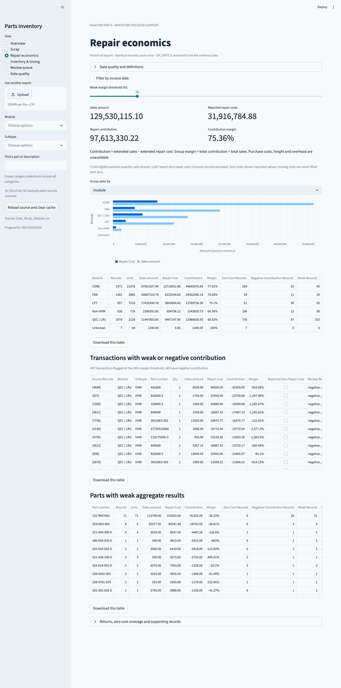
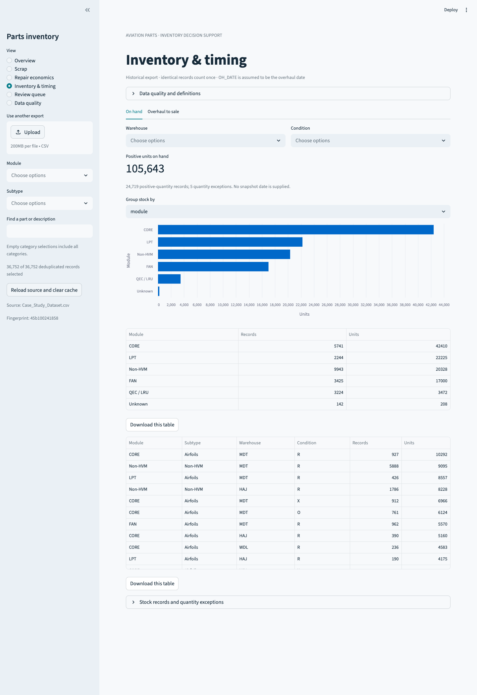
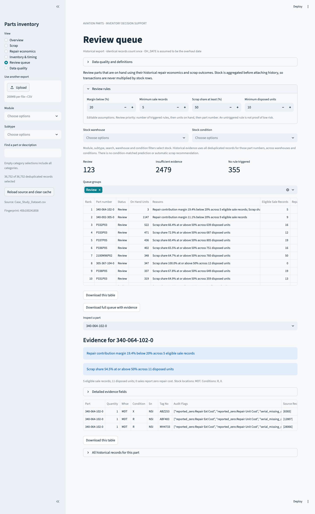

# Parts Inventory Decision Support

For the case-study evaluation, start with the [short submission notes](docs/SUBMISSION.md). This expanded README includes screenshots, results, and implementation detail.

A local Streamlit application for reviewing aviation parts inventory, scrap outcomes, repair contribution, and historical sale timing. It turns a damaged CSV export into traceable calculations and a ranked list of stocked parts to inspect.

Data repairs, calculation eligibility, and business assumptions are visible throughout. The app points a manager toward parts worth investigating; the available data cannot establish future scrap probability or an economically optimal repair decision.


[Run locally](#run-locally) · [Screenshots](#screenshots-and-walkthrough) · [Data decisions](#data-decisions) · [Review logic](#how-the-review-queue-works) · [Verification](#verification) · [Short submission notes](docs/SUBMISSION.md)

## Run locally

Requires **Python 3.11 or newer**, `venv`, and `pip`. On macOS or Linux:

```sh
git clone https://github.com/harshilganapathi/case-study.git
cd case-study
./run.sh
```

Open **http://localhost:8501**. After cloning, `./run.sh` is the single launch command. It creates `.venv`, installs pinned direct dependencies on first use, and starts Streamlit. Initial installation needs PyPI access; subsequent launches reuse the environment.

On Windows, use PowerShell:

```powershell
py -m venv .venv
.\.venv\Scripts\python -m pip install -r requirements.txt
.\.venv\Scripts\python -m streamlit run app.py
```

The supplied CSV loads automatically. Upload a same-schema replacement in the sidebar, or select another file at launch:

```sh
PARTS_DATA_PATH=/absolute/path/to/export.csv ./run.sh
```

The source is never edited. Source bytes and pipeline code determine the cleaning cache key; **Reload source and clear cache** forces a refresh. First load validates and cleans the export; later view changes reuse it. No account, external API, or AI service is used at runtime.

## What the supplied export shows

These are descriptive results after reconstruction and deduplication, not a live stock snapshot or a forecast. Monetary amounts use the source's unspecified currency.

| Measure | Result | Interpretation |
| --- | ---: | --- |
| Positive inventory units | 105,643 | Whole positive Inventory quantities |
| Positive sold units | 35,454 | Returns/credits reported separately |
| Scrapped units | 16,531 | Observed scrapped quantities |
| Observed scrap share | 31.80% | Scrapped / (scrapped + positive sold units) |
| Positive-sale revenue | 129,530,115.10 | Extended amounts, counted once |
| Repair contribution | 97,613,330.22 | Revenue minus repair cost; 75.36% margin |
| Usable overhaul-to-sale intervals | 6,054 | Median 60 days; OH_DATE meaning is assumed |
| Parts flagged for review | 123 | Of 2,957 stocked part numbers |

CORE contributes 12,199 of the 16,531 scrapped units. Non-HVM has an 81.31% observed scrap share across 3,847 disposed units, warranting inspection of its mix and history. Meanwhile, **2,479 stocked part numbers (83.8%) lack minimum evidence under the queue's default rules**. Improving history coverage is a separate task from investigating the 123 flagged parts.

## Screenshots and walkthrough

Screenshots use the supplied export. They show selected states; the [validation report](reports/VALIDATION.md) distinguishes automated checks, browser interaction, and visual inspection.

### Scrap

Compare scrapped and positive sold units by module, subtype, their intersection, or part. Inspect denominators before interpreting a high share. Downloads retain quantities and record counts.


### Repair economics

Compare extended sales against extended repair costs, then inspect weak or negative contribution. Possible credits, missing amounts, and reported zero repair costs remain visible. Adjust the margin threshold or filter by invoice date.



### Inventory and timing

Break stock down by module, subtype, warehouse, and condition. Compare completed-sale intervals with the supplied expectation. The scatterplot defaults to a labeled 0–1,000-day focus; switching to full range changes the chart without changing statistics or exports.




### Review queue

Select a flagged stocked part, read its complete reasons, then inspect history and stock locations. Switch queue groups to investigate insufficient evidence or supported histories without a triggered rule. The full queue can be exported with its evidence.



### Data quality

Inspect how raw rows became calculation records, what was reconstructed, and what was excluded. Unknown classifications remain in totals and breakdowns.


Additional captures show the [mobile overview](reports/screenshots/overview-mobile.png) and [financial cards at a narrower desktop width](reports/screenshots/repair-narrow-window.png). Wide detail tables scroll horizontally.

## Data decisions

**39,338 raw rows → 37,003 reconstructed/complete records → 36,752 records after removing 251 exact duplicate copies.** Two ambiguous pairs, comprising four source rows, remain quarantined.

| Issue | Treatment and reason |
| --- | --- |
| Encoding/schema | Strict UTF-8, then strict Windows-1252. Require the exact header and Type labels (`Inventory`, `Invoiced`, `Scrapped`); even padded Type labels are quarantined. Quarantine unexpected row structures. |
| Split records | Recover 2,331 pairs only when their structure satisfies the reconstruction rules. Preserve source references, missing condition, and the unlabelled continuation value. Do not guess ambiguous pairs. |
| Exact duplicates | Assume identical reconstructed source records are repeated export copies. Count the first once; retain all copies in audit evidence. Compare every source field plus the unlabelled value before normalization. Part number alone never establishes a duplicate. |
| Identifiers/categories | Preserve identifier strings, trim whitespace, keep supplied Non-HVM categories, and display missing classifications as Unknown. |
| Signed quantities | Report negative-quantity invoices separately as possible returns/credits. Preserve nonpositive/fractional quantity exceptions. |
| Missing versus zero | Missing cost stays unknown. Reported zero stays zero, with coverage shown for inspection. |
| Dates | Accept M/D/YYYY and YYYY-MM-DD, flag invalid dates and negative intervals, and preserve valid observed intervals when their expectation is unusable. |

The raw file is unchanged. [Audit evidence](reports/audit/AUDIT_REPORT.md) includes hashes, source-level reconstruction/duplicate records, quarantine, and the calculation population. Each metric applies its own eligibility rules: a missing date does not erase a valid stock quantity.

## Calculation definitions

**Scrap share:** positive scrapped units / (positive scrapped + positive sold units). Inventory has no observed disposal outcome; possible returns are separate. Overall share uses overall units, not an average of group percentages. It is an observed outcome share, not a cohort failure probability.

**Repair contribution:** extended sales − extended repair cost. Aggregate margin = total contribution / total sales. Extended amounts already cover quantity and are not multiplied again. Missing purchase cost, freight, and overhead prevent a total-profit calculation. Zero revenue retains contribution but has no percentage margin. Conflicting signs and missing amounts enter exceptions. Grouping assumes comparable currency.

**Inventory:** positive whole-number Inventory quantities. Module, subtype, warehouse, and condition are alternative breakdowns of the same stock total; do not add them together.

**Timing:** invoice date − OH_DATE in calendar days, **assuming OH_DATE means overhaul date**. It is not receipt-to-sale time or current stock age. Exclude returns, invalid dates, and negative intervals. Compare paired records with `AvgNoofSalesDays`, whose origin and starting point are unknown. Expected days must be positive and at most 3,650 by default; unusable expectations do not remove valid observed intervals. Long intervals stay flagged and included. Each deduplicated transaction counts once.

The median individual observed-minus-expected difference is **−25 days across 6,050 paired records**. This differs from subtracting the medians (60 observed and 97 expected): a median of paired differences answers a different question.

Invoice-date filters apply only to repair/timing. Warehouse and condition filters select stock, since sold records lack warehouse information. Module, subtype, and search select the displayed population; the queue attaches full part history as described below.

## How the review queue works

Stock and history are aggregated separately by part before joining, preventing transactions from being multiplied by stock-location rows.

| Rule | Default support | Trigger |
| --- | --- | --- |
| Weak repair economics | At least five eligible positive-quantity sale records with usable amounts | Aggregate contribution margin below 20%, or zero revenue with negative contribution |
| High observed scrap share | At least ten disposed units | Scrap share at least 50% |

Thresholds are editable. Zero-revenue losses retain an unavailable percentage margin. Reported zero repair costs stay in the evidence, with coverage fields.

**Review:** at least one supported rule triggers. **Insufficient evidence:** neither rule meets minimum support. **No rule triggered:** at least one rule has support but neither triggers. Neither of the latter statuses establishes low risk; inspect support for each rule.

Rank by triggered-rule count, then on-hand units descending, then part number. A small holding with two triggers can outrank a larger holding with one. This is reproducible inspection priority, not expected financial loss. The scrap minimum counts units: **a single bulk record can satisfy it**, without independent observations. Outcome-record counts are available in the full evidence export.

Stock filters select locations; historical evidence uses all deduplicated records for those part numbers across locations/conditions, without an invoice-date window. It is not a condition-matched prediction. Confirm lot history, condition, cost coverage, and future quotes before acting.

## Verification

After installation:

```sh
# Rebuild audit and calculation reports from the unchanged source
.venv/bin/python -m src.metrics

# Unit tests and Streamlit AppTest checks
.venv/bin/python -m unittest discover -s tests -v

# Additional behavioral scenarios using the full supplied export
.venv/bin/python scripts/full_export_review.py
```

The checked submission passed **65 tests with zero skips**, **31 full-export behavioral checks**, and a real Chrome sequence covering **39 checks, including 38 captured UI states**. Additional browser regressions reconciled filtered downloads and checked zero-revenue losses on replacement exports. Tests and full-export checks were rerun from the extracted ZIP. These are recorded results, not a guarantee for every export or operating system.

With the app running and Chrome installed, optional browser checks are available:

```sh
./review_browser.sh
.venv/bin/python scripts/browser_review_calculations.py
.venv/bin/python scripts/browser_review_zero_revenue.py
```

`review_browser.sh` installs optional Playwright tooling and captures screens in a separate Chrome profile. Captures require visual inspection; the runner does not approve its own screenshots. Reconciliation scripts target the supplied export's known totals. See [validation scope and evidence](reports/VALIDATION.md).

## Code map

| File | Responsibility |
| --- | --- |
| [`app.py`](app.py) | Views, filtering, caching, charts, downloads |
| [`src/ingest.py`](src/ingest.py), [`src/clean.py`](src/clean.py) | Parsing, split reconstruction, normalization, flags |
| [`src/audit.py`](src/audit.py) | Provenance, duplicates, quarantine, audit artifacts |
| [`src/metrics.py`](src/metrics.py) | SQLite quantity aggregation and report-generation entry point |
| [`src/economics.py`](src/economics.py) | Decimal contribution calculations and exceptions |
| [`src/timing.py`](src/timing.py) | Intervals, paired comparisons, exclusions |
| [`src/decision_support.py`](src/decision_support.py) | Independent stock/history aggregation and review rules |
| [`src/presentation.py`](src/presentation.py) | Shared filters and precise CSV serialization |
| [`tests/`](tests/) | Cleaning, calculation, rule, filtering, and app regressions |

Non-UI calculations use the standard library. pandas serves presentation; conversion to floating-point values is limited to display. Financial calculations and CSV evidence retain Decimal-based values.

## Limits and next steps

Receipt dates, a stock snapshot date, scrap dates, reliable lifecycle identifiers, acquisition costs, future repair quotes, and recovery values are absent. This prevents current stock aging, matched lifecycle probabilities, and an economic repair-or-scrap recommendation. A predictive scrap model was omitted: observed outcomes alone do not establish a validated future-risk model.

Before operational use, confirm duplicate authenticity, OH_DATE meaning, expected-day definitions, zero-cost semantics, and currency. Validate thresholds/ordering with an inventory manager, inspect bulk-lot dependence, and improve history coverage. Engineering follow-ups include locking transitive dependencies and testing more Python/OS combinations.

For team deployment, use an internal authenticated host, controlled uploads, retained source/audit versions, and appropriate access to financial data. Hosting is not required for this submission.

## AI assistance

I used AI assistance extensively for inspection, planning, implementation, tests, browser automation, and documentation. Duplicate treatment and OH_DATE meaning are project assumptions, not verified company definitions. Reproducible checks establish implemented behavior; they do not validate business meanings or the ranking's operational usefulness.

I remain responsible for the submitted code and assumptions. The main decisions to discuss are split-row recovery, deduplication before normalization, signed extended amounts, the scrap denominator, the OH_DATE proxy, and the queue's support and ordering tradeoffs.
