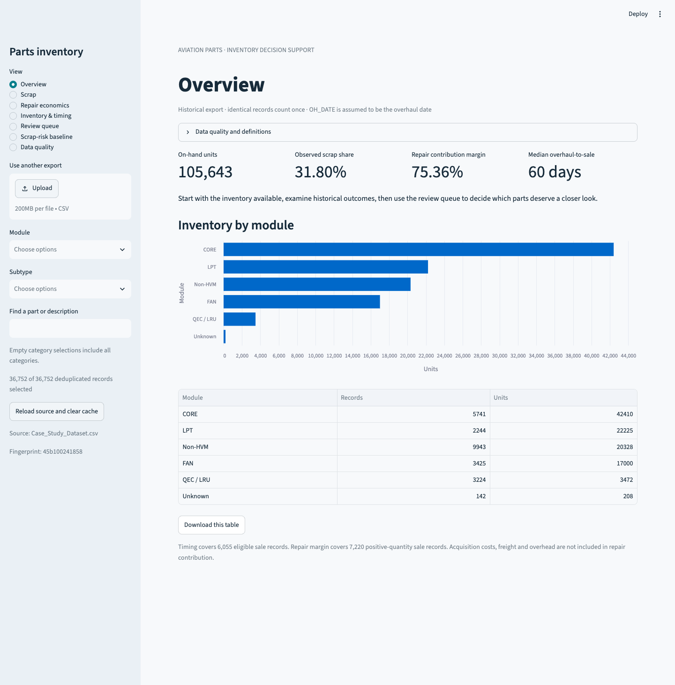
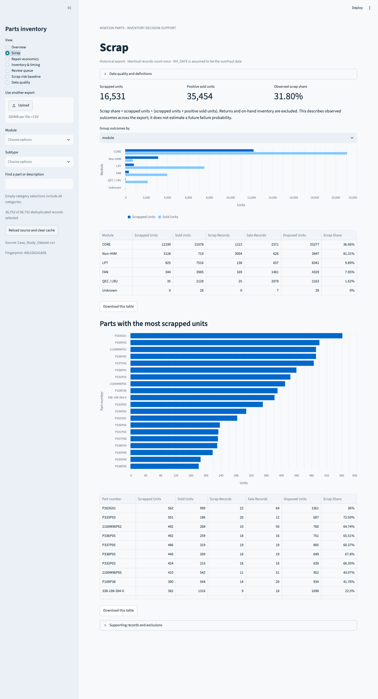
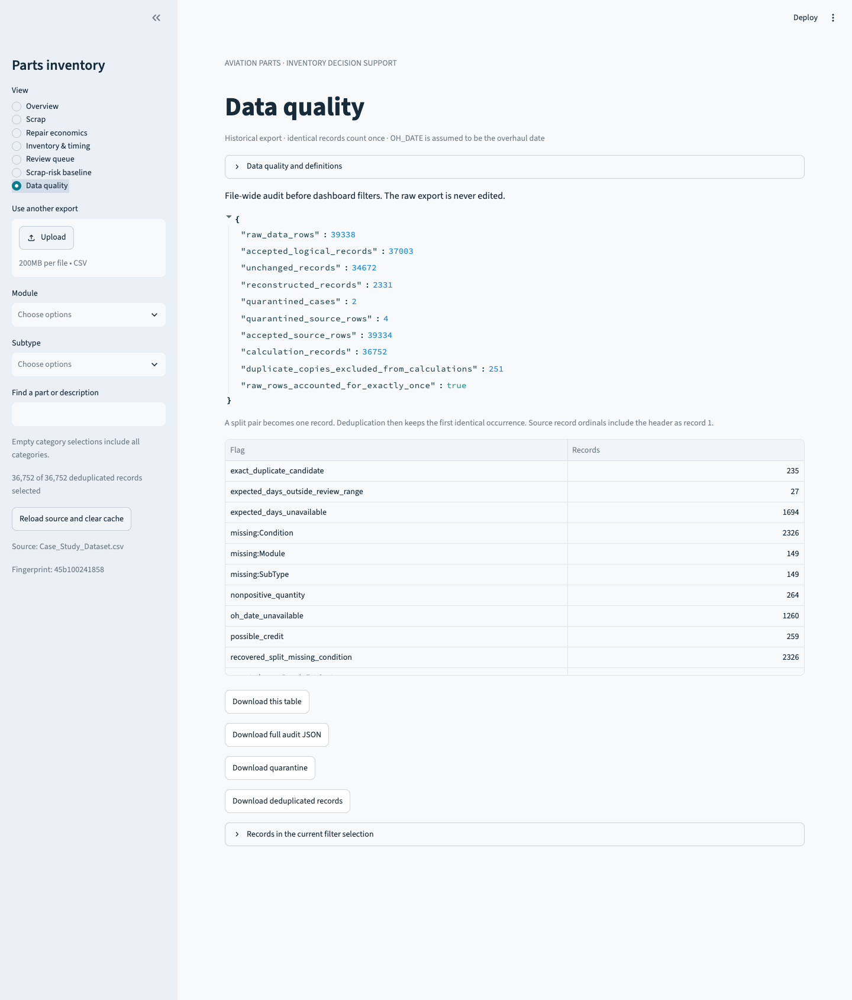

# Parts Inventory Case Study

This is my Streamlit app for the aviation parts case study. It covers stock on hand, scrap outcomes, repair contribution, and how long sold parts took to move from overhaul to invoice. It also includes a review queue and an experimental scrap-risk baseline.

The biggest issue was the export itself: some records were split across two rows, and others were duplicated. I kept the raw file unchanged and made the cleaning repeatable, with source references for the records that were recovered or excluded.



## Run it

Requires **Python 3.11+**, `venv`, and `pip`. On macOS or Linux:

```sh
git clone https://github.com/harshilganapathi/case-study.git
cd case-study
./run.sh
```

Open **http://localhost:8501**. The launcher creates a virtual environment and installs dependencies on the first run, which needs internet access. Later launches reuse that environment.

The supplied CSV loads automatically. You can upload another export with the same schema in the sidebar, or run:

```sh
PARTS_DATA_PATH=/absolute/path/to/export.csv ./run.sh
```

The first load cleans and validates the file; later views reuse the cached data. **Reload source and clear cache** forces a refresh. The app runs locally without an account or an AI API.

<details>
<summary>Windows setup</summary>

Run these commands in PowerShell:

```powershell
py -m venv .venv
.\.venv\Scripts\python -m pip install -r requirements.txt
.\.venv\Scripts\python -m streamlit run app.py
```

</details>

## What I found in the data

The cleaning pipeline takes **39,338 raw rows** to **37,003 reconstructed/complete records**, then **36,752 records after removing 251 duplicate copies**. Two ambiguous pairs, covering four source rows, are quarantined.

The main decisions were:

- **Split rows:** recover the 2,331 pairs that match the validated structure. Keep missing condition unknown and preserve the extra unlabelled value. The two ambiguous pairs remain excluded.
- **Duplicates:** treat identical reconstructed records as duplicate export copies and count them once. Compare all source fields before normalization; a repeated part number alone is not a duplicate. This policy still needs business confirmation.
- **Returns/credits:** keep negative-quantity invoices separate from positive-sale results.
- **Missing costs:** leave them unknown. A reported zero stays zero, with coverage shown in the app.
- **Missing classifications:** keep the records and display Unknown. Part numbers and serials stay strings.

The input contract is deliberately narrow: the exact 25-column header and unpadded Type labels (`Inventory`, `Invoiced`, `Scrapped`). Dates accept M/D/YYYY or YYYY-MM-DD. Unexpected structures are rejected or quarantined.

The [audit report](reports/audit/AUDIT_REPORT.md) has the reconstruction rules, duplicate controls, source hashes, and exclusions.

## What the numbers mean

| Measure | Definition | Supplied export |
| --- | --- | ---: |
| Inventory | Positive whole-number Inventory quantities | 105,643 units |
| Scrap share | Scrapped units / (scrapped + positive sold units) | 31.80% |
| Repair contribution | Extended sales − extended repair cost | 97,613,330.22 |
| Contribution margin | Total contribution / total sales | 75.36% |
| Overhaul-to-sale interval | Invoice date − assumed overhaul date | Median 60 days |

Scrap share excludes inventory and possible returns. It describes the outcomes in this export; it does not predict whether a part will be scrapped.

For repair economics, I use extended amounts once and calculate margin from totals. Purchase cost, freight, and overhead are missing, so **repair contribution is not net profit**. Zero revenue has no percentage margin. Currency is unspecified; aggregation assumes the amounts are comparable.

For timing, **I assume OH_DATE means overhaul date**. Receipt dates are missing, so this measures overhaul-to-invoice time. It cannot tell us current stock age. The comparison uses `AvgNoofSalesDays`, whose starting point is also unconfirmed. Invalid dates and negative intervals are excluded; valid long intervals stay included and flagged.

Two findings worth investigating: CORE accounts for **12,199 of the 16,531 scrapped units**, while Non-HVM has an **81.31% scrap share across 3,847 disposed units**. Both need the underlying part mix and history to interpret them.

More detail: [quantity calculations](reports/metrics/METRICS_EXPLAINED.md), [repair economics](reports/metrics/REPAIR_ECONOMICS_EXPLAINED.md), and [timing](reports/metrics/TIMING_EXPLAINED.md).

## How the review queue works

I chose a ranked review queue as the decision-support feature. It flags stocked parts with weak repair contribution or a high historical scrap share.

| Rule | Minimum evidence | Flag |
| --- | --- | --- |
| Repair economics | Five positive-quantity sale records with usable amounts | Contribution margin below 20%, or zero revenue with negative contribution |
| Scrap outcomes | Ten disposed units | Scrap share at least 50% |

These thresholds are editable. Stock and history are aggregated separately by part, so multiple stock locations do not multiply the historical transactions.

The default queue flags **123 parts**. Another **2,479 of the 2,957 stocked part numbers** do not meet either rule's evidence minimum. The app separates these from parts with enough evidence but no triggered rule. Neither status means low risk.

The order is simple: triggered-rule count, then stock quantity, then part number. That means a small holding with two flags can rank above a much larger holding with one. Also, one bulk record can meet the ten-unit scrap minimum. These are limits of the rule, and the full evidence export includes historical record counts.

Stock filters select the locations of interest; the queue uses full history for those part numbers across conditions and locations, without a date window. A flag is a reason to inspect the part and its history before making a repair or scrap decision.

## Scrap-risk baseline

I added a simple category model using Module and SubType. It learns from sold and scrapped records, pulling sparse groups toward broader history. Condition, dates, costs, prices, quantities, and identifiers are excluded from the predictors to avoid leaking the recorded outcome.

The check holds out **354 whole part numbers**: none of their records enter training. On the 1,753 held-out records, the model's Brier score is **0.1415**, versus **0.2611** for a constant training-rate score; lower is better. ROC AUC is **0.8608**. The app shows the comparison and calibration bins, then refits on all eligible history to score stock. Parts in the same categories share a score.

Each deduplicated outcome record counts once, so this differs from the unit-weighted scrap share. It is a baseline for historical outcome patterns. Missing scrap dates and lifecycle cohorts prevent a temporal test or a future-risk claim. The [model report](reports/metrics/SCRAP_MODEL_EXPLAINED.md) explains the formulas, exclusions, split, and limits. Stock scores, held-out predictions, and calibration tables have CSV exports.

## Screenshots

All captures below use the supplied export. The app has category/search filters and CSV downloads; invoice-date filters apply to repair and timing. Warehouse and condition filters apply to stock.

<details>
<summary>Scrap</summary>

Scrapped and sold units, observed shares, and the most frequently scrapped parts.



</details>

<details>
<summary>Repair economics</summary>

Sales, repair costs, weak contributions, and cost coverage.


</details>

<details>
<summary>Inventory and timing</summary>

Stock breakdowns and observed-versus-expected sale intervals. The chart's 0–1,000-day focus does not change statistics or downloads.


</details>

<details>
<summary>Review queue and data quality</summary>

Editable review rules, part-level evidence, and the cleaning summary.




</details>

Additional captures: [mobile overview](reports/screenshots/overview-mobile.png) and [narrower desktop layout](reports/screenshots/repair-narrow-window.png). Wide tables scroll horizontally.

<details>
<summary>Scrap-risk baseline</summary>

Held-out performance, calibration, and stock scores with supporting category history.


</details>

## Checks and code

After installation:

```sh
# Rebuild the audit and calculation reports
.venv/bin/python -m src.metrics

# Run unit tests and Streamlit AppTest checks
.venv/bin/python -m unittest discover -s tests -v

# Exercise all views against the full export
.venv/bin/python scripts/full_export_review.py
```

The checked version passed **79 tests** and **35 full-export checks**. The Chrome review covers all seven views, filters, and empty states. Additional browser checks reconcile downloaded totals and test zero-revenue losses. See the [validation report](reports/VALIDATION.md) for scope, evidence, and browser commands.

`app.py` handles the UI. Under `src/`, ingestion and audit code prepare the records; separate modules calculate quantities, economics, timing, and review rules. Quantity aggregation uses SQLite. Financial calculations use Decimal, with float conversion limited to display.

## What I would do next

First, confirm the field definitions, duplicate policy, zero-cost meaning, and currency with the business. Then review the queue thresholds and ordering with an inventory manager.

Receipt/snapshot dates, reliable lifecycle IDs, acquisition costs, future repair quotes, and scrap recovery values would make the app more useful. Without them, I left out current stock aging and automatic repair-or-scrap recommendations. The experimental scrap baseline needs prospective validation before operational use.

For a team deployment, I would add authentication, controlled uploads, and retained source/audit versions. I would also lock transitive dependencies and test more Python/OS combinations. The current launcher was checked on macOS; Windows instructions are provided but were not validated.

## AI use

I used Codex throughout the project. I drove the direction and made the final decisions.

For a shorter submission overview, see [submission notes](docs/SUBMISSION.md).
