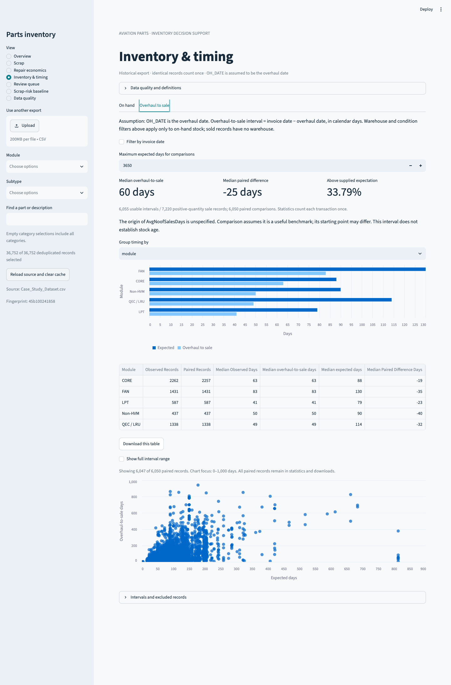
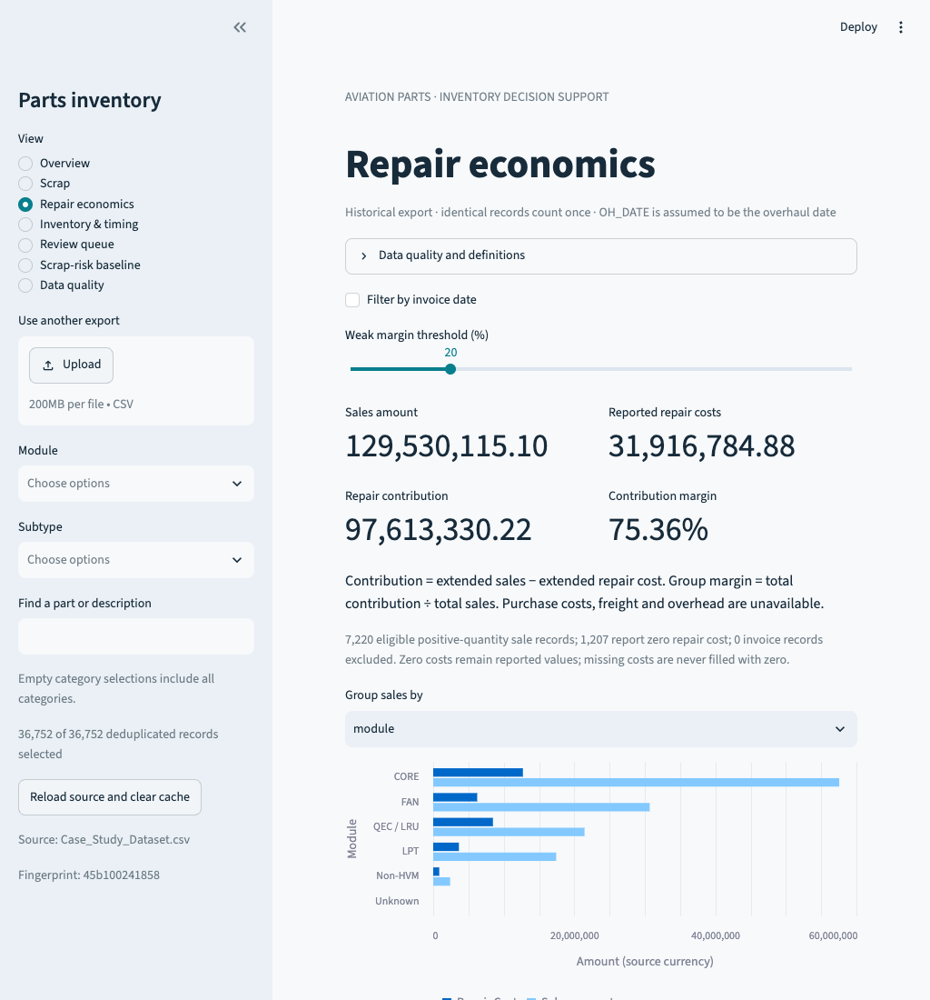

# Parts Inventory Case Study

A local Streamlit app for reviewing aviation parts inventory, scrap outcomes, repair contribution, sale timing, and parts worth investigating. It includes an experimental scrap-risk baseline and CSV exports.

## Setup

Requires **Python 3.11+**, `venv`, and `pip`. On macOS/Linux:

```sh
git clone https://github.com/harshilganapathi/case-study.git
cd case-study
./run.sh
```

Open **http://localhost:8501**. The first launch creates `.venv` and installs dependencies, which needs internet access. The supplied CSV loads automatically. The app runs locally without an account or AI API. [Windows setup and replacement exports](docs/SETUP.md).

## Features

- **Scrap:** quantities, observed scrap shares, and frequently scrapped parts.
- **Repair economics:** sales against repair costs, contribution margins, and weak/negative results.
- **Inventory and timing:** stock by module, subtype, warehouse, and condition; observed intervals against supplied expected days.
- **Review queue:** ranked stocked parts, editable rules, supporting history, and locations.
- **Scrap-risk baseline:** category scores, held-out evaluation, calibration, and stock scoring.
- **Data quality:** reconstruction, duplicate treatment, quarantine, and exclusions.

Tables have CSV downloads. Category/search filters select the displayed population. Invoice-date filters apply to repair/timing; location/condition filters select stock. Queue and model history use the full deduplicated export for their stated scope. [Screenshots](#screenshots).

## Definitions and assumptions

**Timing: OH_DATE is assumed to mean overhaul date.** The interval is invoice date minus OH_DATE: **overhaul-to-invoice time, not current stock age or confirmed receipt-to-sale time**. The origin of `AvgNoofSalesDays` is unknown, so its starting point may differ.

| Measure | Calculation | Supplied export |
| --- | --- | ---: |
| Inventory | Positive whole-number Inventory quantities | 105,643 units |
| Scrap share | Scrapped / (scrapped + positive sold units) | 31.80% |
| Repair contribution | Extended sales − extended repair cost | 97,613,330.22 |
| Contribution margin | Total contribution / total sales | 75.36% |

Scrap share excludes inventory and possible returns. Extended amounts already cover quantity and are used once. Contribution excludes acquisition cost, freight, and overhead; it is not net profit. Currency is unspecified, and aggregation assumes comparable amounts.

I kept the raw CSV unchanged. The 39,338 rows become 37,003 reconstructed/complete records, then **36,752 after removing 251 exact duplicate copies**. Two ambiguous pairs remain quarantined. Identical reconstructed records are assumed to be export duplicates; part number alone never establishes duplication. Missing costs remain unknown, reported zeros stay zero, and unknown classifications remain included.

The review queue flags contribution margin below 20% (or zero-revenue losses) with five eligible sale records, or scrap share at least 50% with ten disposed units. It ranks by triggered rules, stock quantity, then part number. A single bulk record can meet the unit minimum. Insufficient evidence and no triggered rule both require care; neither means low risk.

The model uses only Module/SubType and counts each completed outcome record once. Whole part numbers are held out for evaluation, then a separate full-history refit scores stock. Scores describe historical category patterns, without a validated future-risk time horizon.

## Limits and next steps

Receipt/snapshot/scrap dates, reliable lifecycle IDs, acquisition costs, repair quotes, and recovery values are missing. The app cannot establish stock age, cohort scrap probability, or an automatic repair-or-scrap decision. I would confirm field meanings, duplicates, zero costs, and currency first, then validate the rules/model with an inventory manager. Team use would need authentication, controlled uploads, retained audit versions, and broader environment testing.

## Verification and supporting material

```sh
.venv/bin/python -m unittest discover -s tests -v
.venv/bin/python scripts/full_export_review.py
```

The final checked version passed **79 tests, 35 full-export checks, and 44 Chrome checks**. Scope and evidence are in the [validation report](reports/VALIDATION.md). Rebuild reports with `.venv/bin/python -m src.metrics`.

Supporting detail: [audit](reports/audit/AUDIT_REPORT.md), [quantities](reports/metrics/METRICS_EXPLAINED.md), [economics](reports/metrics/REPAIR_ECONOMICS_EXPLAINED.md), [timing](reports/metrics/TIMING_EXPLAINED.md), [review rules](reports/metrics/REVIEW_QUEUE_EXPLAINED.md), [model](reports/metrics/SCRAP_MODEL_EXPLAINED.md), and [code structure](IMPLEMENTATION_PLAN.md).

## AI use

I used Codex throughout the project. I drove the direction and made the final decisions.

## Screenshots

Click a view to expand its screenshot.

<details>
<summary>Overview</summary>


</details>

<details>
<summary>Scrap</summary>


</details>

<details>
<summary>Repair economics</summary>


</details>

<details>
<summary>Inventory and timing</summary>




</details>

<details>
<summary>Review queue</summary>


</details>

<details>
<summary>Scrap-risk baseline</summary>


</details>

<details>
<summary>Data quality</summary>


</details>

<details>
<summary>Smaller screens</summary>




</details>
