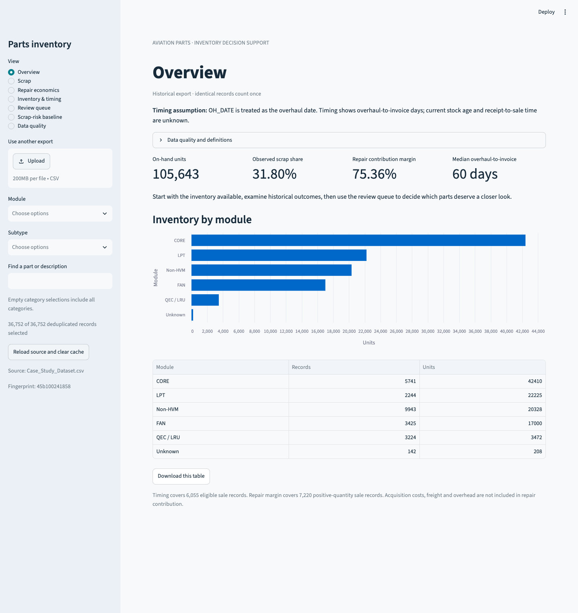
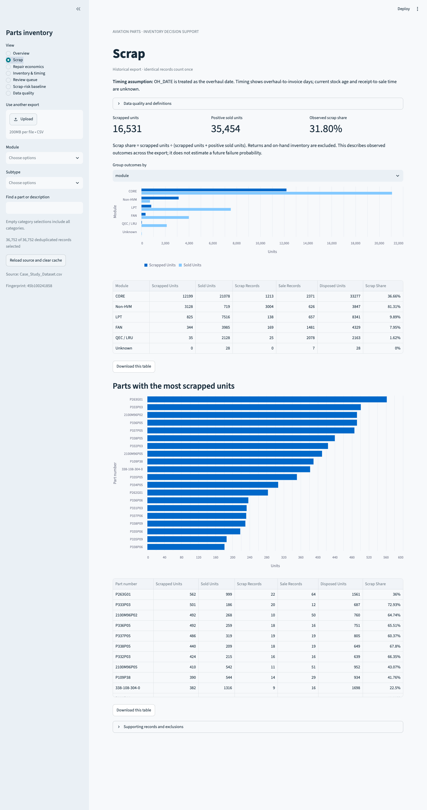
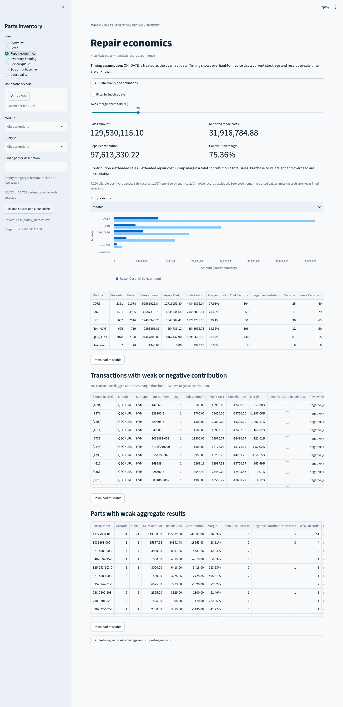
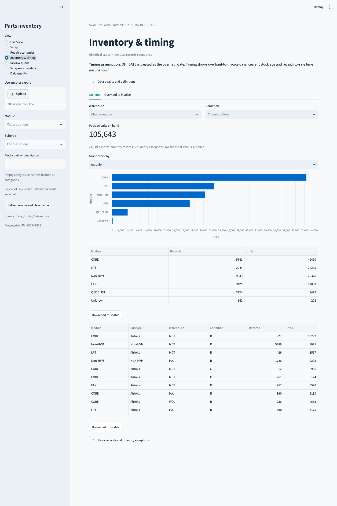
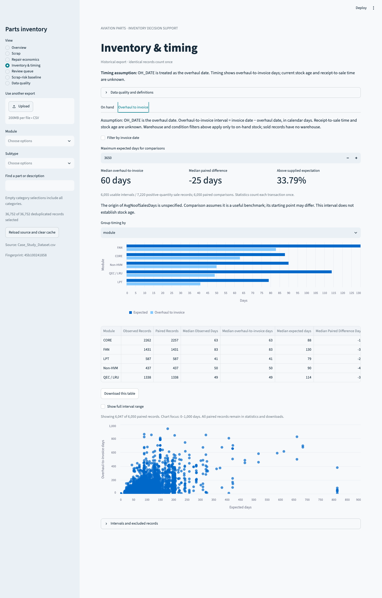
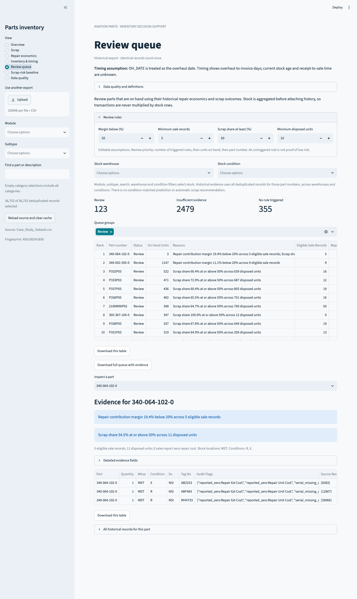
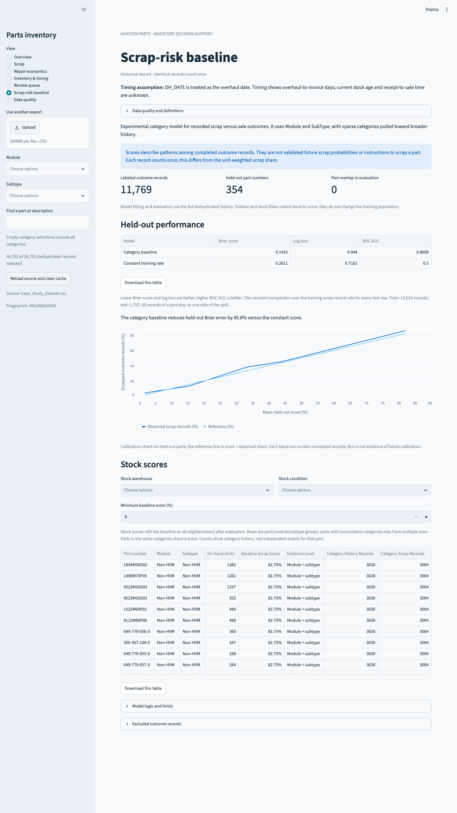
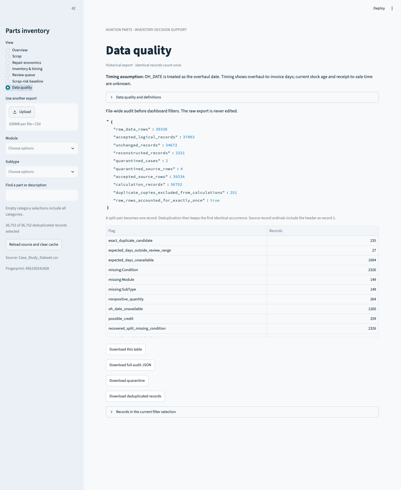
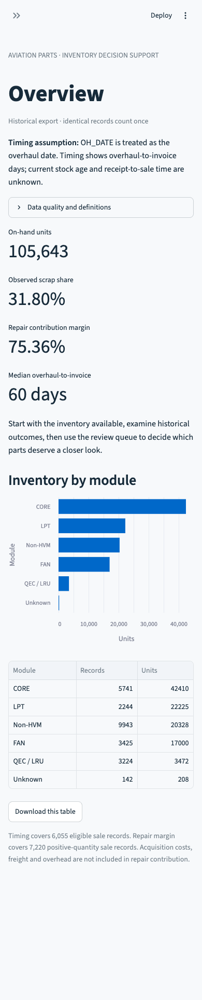
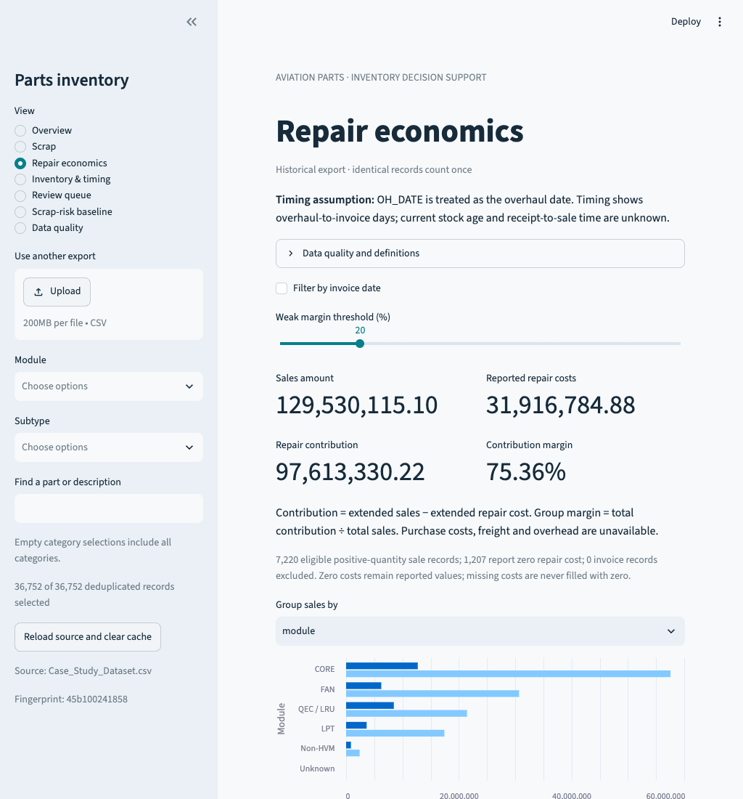

# App screenshots

Selected captures using the supplied export. [Validation scope and evidence](../reports/VALIDATION.md).

## Overview

## Scrap

## Repair economics

## Inventory and timing

## Review queue

## Scrap-risk baseline

## Data quality

## Smaller screens

Wide detail tables scroll horizontally. CSV downloads preserve their full contents.
